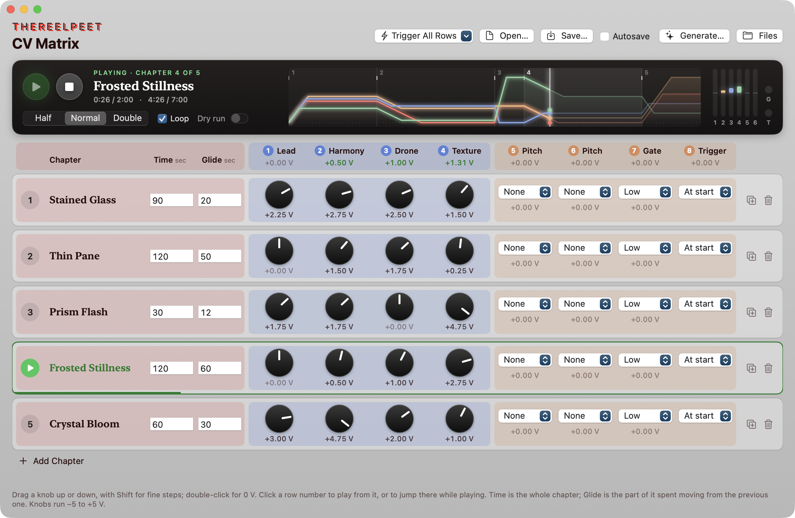

# THEREELPEET CV Matrix

A small Mac app that turns an Expert Sleepers **ES-8** into eight slowly moving control voltages for a modular rack.

You write a piece as a list of **chapters** (rows). Each row holds eight voltages (one per ES-8 output, -5 to +5 V), how long the row lasts, and how much of that time is spent gliding in from the previous row. Press play and the rows run top to bottom, optionally looping. The outputs never jump: every change is a glide. On its own it runs fully offline and sends nothing anywhere except the ES-8. An optional button can ask Claude to write a new piece (see [Generate with Claude](#generate-with-claude-optional)).

It is made for long, evolving pieces: level or rate CVs, slow offsets, crossfades, anything that should drift over minutes rather than steps.

## What you need

- A Mac running macOS 14 or later
- An Expert Sleepers ES-8 connected over USB (not needed for a dry run)
- To build it: Xcode and Swift 5.9 or later (it was built and tested with the full Xcode, not the Command Line Tools alone)

It has been tested on Apple Silicon with an ES-8. There is no prebuilt download, so you build it yourself (below).

## Install

    git clone https://github.com/boocup/cv-matrix.git
    cd cv-matrix
    ./scripts/make-app.sh

That makes `dist/CVMatrix.app` (a release build with an icon, signed ad hoc). Drag it into `/Applications`.

The first time you open it, macOS may refuse because the app is not notarised. Right-click it, choose **Open**, then confirm. You only need to do this once.

macOS may ask for microphone access. The ES-8 is one audio device with both inputs and outputs, so the system treats opening it as possible recording. CV Matrix only sends voltages and never reads the inputs, so you can allow or deny it.

To run it without building the `.app`, or if the build fails, see [Build from source](#build-from-source).

## Build from source

1. **Install Xcode** from the App Store (it was built and tested with the full Xcode, not the Command Line Tools alone), open it once so it finishes installing components, and accept the license if asked:

        sudo xcodebuild -license accept

2. **Check the toolchain** points at the full Xcode and that Swift works:

        xcode-select -p        # should print /Applications/Xcode.app/Contents/Developer
        swift --version

   If `xcode-select -p` shows `/Library/Developer/CommandLineTools`, switch it:

        sudo xcode-select -s /Applications/Xcode.app/Contents/Developer

3. **Get the code:**

        git clone https://github.com/boocup/cv-matrix.git
        cd cv-matrix

4. **Build and run it**, either way:

        swift run                 # debug build, starts the app straight away
        ./scripts/make-app.sh     # release build, makes dist/CVMatrix.app

   `make-app.sh` builds in release mode, draws the icon, writes the `Info.plist`, and signs the app ad hoc. It needs only Xcode and the tools that ship with macOS (`swift`, `sips`, `iconutil`, `codesign`). The result is `dist/CVMatrix.app`; the `dist/` folder is not committed.

Other commands:

    swift build               # compile only (debug)
    swift build -c release    # compile only (release)
    rm -rf .build dist        # clean everything built

The project is a Swift package (`Package.swift`) with no third-party dependencies, so there is nothing to download besides the code. There is no Xcode project file; to work on it in Xcode, open the folder (File > Open) and Xcode will use the package.

If the build fails, the usual causes are an older Xcode than macOS 14 supports, or the toolchain still pointing at the Command Line Tools (step 2).

## First run: do this before patching it into anything

A wrong voltage goes into real gear. The first time:

1. Patch **only Out 1** to a multimeter or to an ES-8 input you can read back. Leave everything else unpatched.
2. Set one row with Out 1 at +2 V and a glide of a few seconds.
3. Press play and check the meter. It should read about +2 V.

Full scale (+-1.0 in the audio stream) is assumed to be about +-10 V on the jack. The author measured it about 1% low at 1, 2.5 and 5 V. Your unit may differ, so check it.

## Using it

| To do this | Do this |
|---|---|
| Change a voltage | Drag a knob up or down (200 px is the full 10 V) |
| Fine adjust | Hold **Shift** while dragging (ten times finer) |
| Set a knob to 0 V | Double-click it |
| Shift Out 5 or 6 by an interval | Pick it from the menu: None, major 3rd, 4th, 5th or octave (1 V/oct, upward). Custom lets you type any voltage |
| Gate on Out 7 | Pick Low (0 V) or High (+5 V) from the menu. It is held for the whole row and snaps, with no glide |
| Trigger on Out 8 | Pick None, At start or After glide. It sends a 20 ms +5 V pulse at the start of the row, or when its glide has finished |
| Play from a row | Click its round number badge, or click its chapter in the visualizer |
| Jump to another row while playing | Click that row's badge |
| Stop | Press **Stop** (⌘.); every output glides to 0 V |
| Add, copy or remove a row | **Add Chapter** under the rows, or the copy and trash buttons at the end of each row |
| Leave a text box | Press **Escape** or click empty space |

Each row has:

- **Chapter**: a name, up to 40 characters, shown as a title. Double-click it to rename; Return or Escape finishes.
- **Time**: how long the row lasts, in seconds (1 to 3600).
- **Glide**: how many of those seconds are spent moving from the previous row's voltages to this row's. It can't be longer than the time.
- **Outputs 1 to 4** (Lead, Harmony, Drone, Texture, on a blue band): knobs, -5 to +5 V.
- **Outputs 5 and 6** (Pitch, on an orange band): pitch-shift menus (None, major 3rd, 4th, 5th, octave, or Custom).
- **Output 7** (Gate): a gate menu (Low or High).
- **Output 8** (Trigger): a trigger menu (None, At start, After glide).

The numbered badge in each column heading is the ES-8 output it drives.

Along the top, next to the THEREELPEET wordmark: **Trigger All Rows** sets Out 8's trigger on every row at once, **Open…** (⌘O) and **Save…** (⌘S) load and save grid files, **Autosave** (off at every launch, see Files below), **Generate…** asks Claude for a new piece, and **Files** shows the grid folder in Finder.

Under that is the dark **display**:

- **Play** (⌘Return) starts from the selected chapter; **Stop** (⌘.) glides every output to 0 V.
- The readout shows the chapter that is playing (or the selected one, when stopped), with its time and the whole piece's time.
- **Half / Normal / Double**: playback speed for the whole piece. A grid saved with some other speed keeps it, and none of the three is highlighted.
- **Loop**: go back to row 1 after the last row. Otherwise it stops and glides to 0 V.
- **ES-8 / Dry run**: on at every launch. Switch it off for a **dry run** that shows the computed voltages without sending anything.
- The **visualizer** draws the whole piece, one colored line per output (1 Lead, 2 Harmony, 3 Drone, 4 Texture, 5 and 6 Pitch), as it plays from chapter 1, with chapter numbers along the top, gate-high stretches as an amber bar along the bottom and triggers as small ticks. While playing, a playhead moves across it, the part already played lights up, and a dot on each line shows where that output really is. Click anywhere in it to play from that chapter, or to jump there while playing.
- The **meters** on the right show outputs 1 to 6 live, as bars up or down from 0 V. **G** lights while the gate is high, and **T** flashes on each trigger.

The small numbers under each column heading are where that output is right now, so you can watch the glides.

If you change a knob on the row that is playing, that output follows it with a half-second glide. Edits to other rows take effect when those rows play.

The window sizes itself to show every row when it opens (up to the size of your screen).

## Generate with Claude (optional)

The **Generate…** button asks Claude to write a new piece and loads it. It is optional: without it, the app never touches the network.

It works by running `chapters.py` from your own copy of [ambient-agent](https://github.com/boocup/ambient-agent) with the Claude backend. The app itself makes no network call and never sees your API key. The script runs in a login shell, so it picks up `ANTHROPIC_API_KEY` from your shell setup, and the key stays inside that process.

You need:

- an ambient-agent checkout with its `.venv` set up (see its README), at `~/vcv-dev/ambient-agent` or anywhere else you point the app at with **CV Matrix > Choose ambient-agent Folder...** (it is remembered)
- `ANTHROPIC_API_KEY` exported in your shell (for example in `~/.zshrc`)
- a recent ambient-agent: `chapters.py` needs its `--write-grid-dir` option

How it goes:

1. Click the button. A window asks you to describe your voices and what you want, in your own words ("Voice 1 and 2 are similar, voice 2 repeats note one. Voice 3 is a tape delay loop of voice 1. Sparse and dark please."), and for the number of **voices** (1 to 8) and **chapters** (1 to 12). The app remembers all three. Leave the description empty for the built-in four-voice setup. Click **Generate** (or press Cmd-Return). Claude writes the chapters one after another, and the main window shows which one it is on. **Cancel** stops it.
2. Each run costs a few cents of API credit (one request per chapter).
3. The new piece is saved as a grid file, named by date, time and its first chapter (for example `2026-10-15-0942-quiet-dawn-emergence.json`), in `~/Documents/CV Matrix/`. Existing files are never overwritten. **Files** opens that folder in Finder.
4. The app loads it and selects row 1. **It does not start playing.** Press Play when you are ready.
5. If something would be lost by loading (music is playing, or the current grid has edits you haven't saved), the app asks first. The new file is saved either way.

Levels 0 to 1 become 0 to 5 V: voice 1 on Out 1, voice 2 on Out 2, and so on. Outputs beyond your voice count start at 0 V.

## How the glide works

When a row starts, the largest voltage change across the eight outputs takes exactly the glide time. Outputs with smaller changes get there sooner and then wait. All eight share one speed in volts per second. Very short glides are treated as at least 0.2 s so an output never snaps.

On Stop, on reaching the end of a piece, and on quit, the outputs glide back to 0 V at 10 V per second before the audio device is closed.

## Files

The grid is a small JSON file:

    {
      "rows": [
        {
          "name": "Quiet Dawn Emergence",
          "time": 120,
          "glide": 30,
          "values": [1.75, 0, 0.6, 2.5, 0, 0, 0, 0]
        }
      ],
      "speed": 1.0,
      "loop": false
    }

Grid files live in `~/Documents/CV Matrix/`: **Open…** and **Save…** open there, and Generate with Claude saves there. The folder is created the first time it is needed, and macOS may ask once whether the app may use your Documents folder.

- **Open…** loads a file like this. It asks before replacing the current grid and stops playback first. Loading never writes back to the file you opened.
- **Save…** saves a copy of the current grid wherever you choose. It suggests the name of the file you last opened or saved, without the date or corpus-id prefix.
- **Autosave** is a switch, off at every launch. When ticked, the current grid is written as you edit, to `~/Library/Application Support/CVMatrix/matrix_grid.json`, and that file is what the app opens at launch. With it off, your edits are lost when you quit unless you used Save….

## Safety and limits

- Every output is capped at **+-5 V** in the code, whatever the grid says.
- Outputs 1 to 6 move by gliding only; they never jump to a new value. The two exceptions are marked in the grid: **Out 7** is a gate that snaps between 0 V and +5 V, and **Out 8** only ever sends a short +5 V trigger pulse (20 ms) and is otherwise 0 V. Both are capped at +5 V like everything else, and both go to 0 V on Stop and quit. Keep Out 7 and 8 away from level or pitch inputs.
- The ES-8 is opened only when you press play with **Send to ES-8** ticked, and released when the outputs reach 0 V.
- Only ES-8 outputs 1 to 8 are used. macOS reports 16 outputs, but the rest are ADAT channels that only carry signal with an expander.
- After the rack is power cycled, the ES-8 can disappear from the Mac until its USB cable is unplugged and plugged back in. If the app says it can't find or start the ES-8, do that and try again.
- Quit with Cmd-Q or by closing the window, not by killing the process. A quit glides the outputs to 0 V first; a kill does not.
- This is a hobby project with no warranty. Check voltages before patching into anything you can't afford to damage.

## Project layout

    Sources/CVMatrix/
      CVMatrixApp.swift   app entry, window and quit handling
      ContentView.swift   the grid screen
      Display.swift       the dark display: transport, readout, visualizer, meters
      KnobView.swift      the knobs and output menus
      Theme.swift         the THEREELPEET panel colors
      Model.swift         rows and the grid file format
      Store.swift         the grid, loading, saving
      Player.swift        play logic and glides
      ES8Output.swift     Core Audio output to the ES-8
      Generator.swift     runs ambient-agent's chapters.py for Generate with Claude
    scripts/
      make-app.sh         builds dist/CVMatrix.app
      make-icon.swift     draws the app icon

## Not yet done

- A separate glide speed per output, so every output takes the full glide time

## License

[MIT](./LICENSE), by Pete Buchhop.
